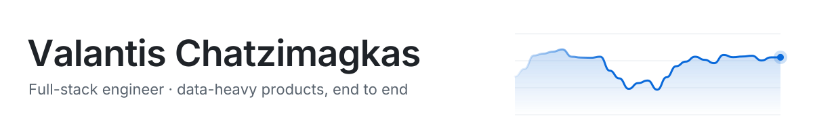

<picture>
  <source media="(prefers-color-scheme: dark)" srcset="assets/banner-dark.svg">
  
</picture>

**Dossenheim, Germany** · [LinkedIn](https://www.linkedin.com/in/valantischatzimagkas)

I build data-heavy products end to end, from ingestion and APIs to the UI that people use. Across 6+ years that has meant IoT platforms and EU research projects, production geospatial pipelines, and now a multi-tenant finance SaaS with LLM agents built in. MSc in Informatics Engineering.

### Now: ARC Intelligence (2026–)

Multi-tenant B2B finance platform on Django REST, Next.js and AWS.

- **Agentic chat:** dashboard and chart features generated by our LLM agents, agent artifacts, filtering and chat-interface work. Currently building human-in-the-loop interactions so users can step in while the agent works.
- **Prompt evaluation:** contributed to prompt evals for checking agent behaviour before changes ship.
- **Auth and data:** user authentication and management on AWS Cognito; database migrations as the platform evolves.

### Before

- **KISTERS** (2025–26): refactored and migrated production geospatial pipelines; integrated new weather-forecast models behind a single trigger flow.
- **Future Intelligence** (2020–25): data-platform services and R&D for IoT, Industry 4.0, smart agriculture and circular economy; led and coordinated tasks within EU research projects.

### Toolbox

- **Backend:** Python (Django REST, FastAPI, SQLAlchemy), Go
- **Frontend:** TypeScript, React, Next.js
- **Data:** PostgreSQL, PostGIS, TimescaleDB, InfluxDB, Redis, MongoDB
- **AI:** OpenAI SDK, agent tooling, evals
- **Infra:** AWS, Docker, GitHub Actions

### Selected projects

| Project | The interesting part |
|---|---|
| [synaptic-hive](https://github.com/ValantisChatzimagkas/synaptic-hive) | Industrial IoT telemetry on TimescaleDB with a switchable sync/async ingestion path: an at-least-once Redis Streams worker that is idempotent on redelivery. |
| [Road-Archiver](https://github.com/ValantisChatzimagkas/Road-Archiver) | Versioned road networks on PostGIS: updates never delete, and any network can be queried exactly as it was at a given instant. |
| [brewing-temperature-monitor-app](https://github.com/ValantisChatzimagkas/brewing-temperature-monitor-app) | Go time-series API on InfluxDB: strict input grammar instead of injectable query strings, with handlers tested behind a store interface. |

My day-to-day work is in private repositories; these are smaller projects where I work through ideas in the open.
